# Описание решения задачи "Выбор и реализация решения для пакетной обработки данных" #

В данном решении код в файле `/dags/check-payments.py` читает csv файлы с заказами и платежами, совмещает их и проводит:

1. Обогащение информации о заказе информацией о платеже.
2. Поиск просроченных платежей.
3. Поиск платежей, которые не удалось соотнести с заказами.

## Диаграмма потоков данных ##

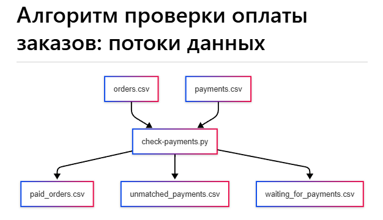

## Workflow диаграмма (алерты) ##

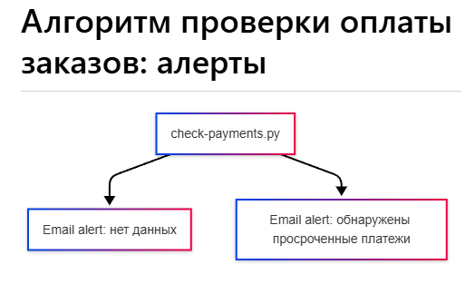

*Прим. алерты для случая непонятных платежей пока не созданы.*

## Структура каталогов файлов данных ##

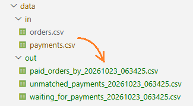

## Скриншоты из Apache Airflow ##

**Home page**
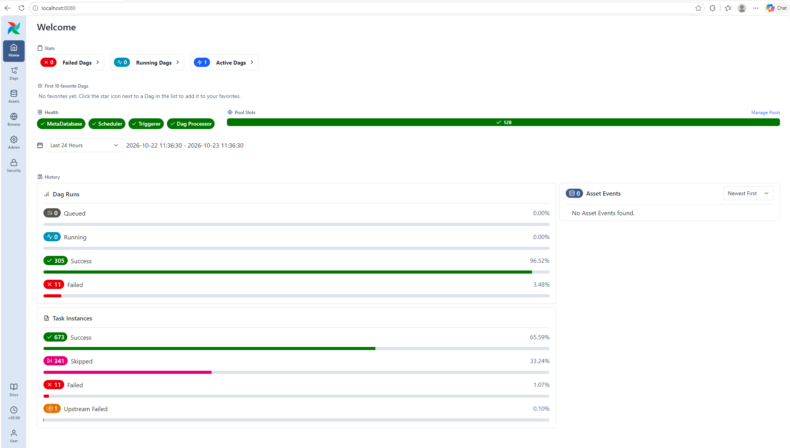

**Список заданий**
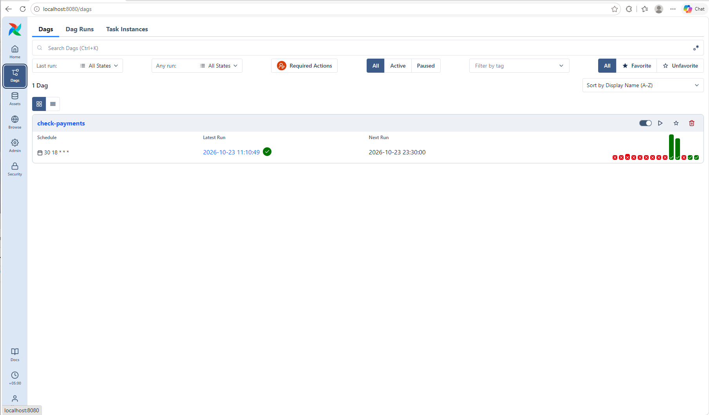

**Успешный сценарий без алертов**
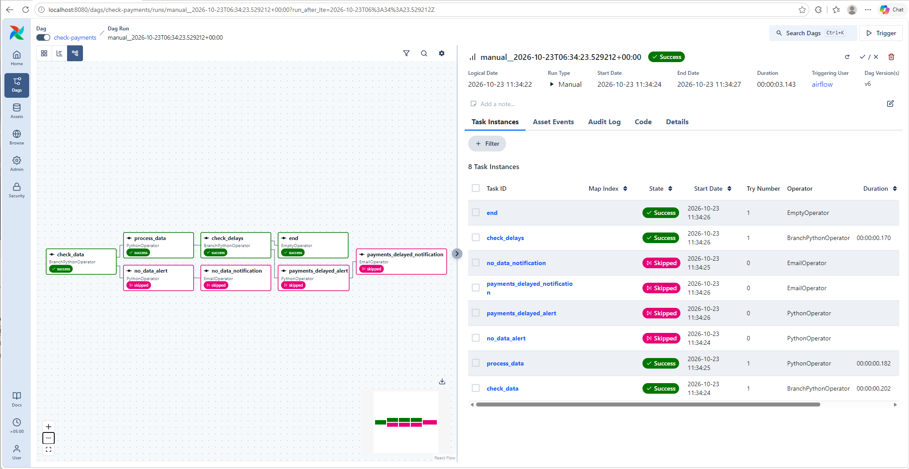

**Cценарий c Email алертом из-за отсутствия данных**
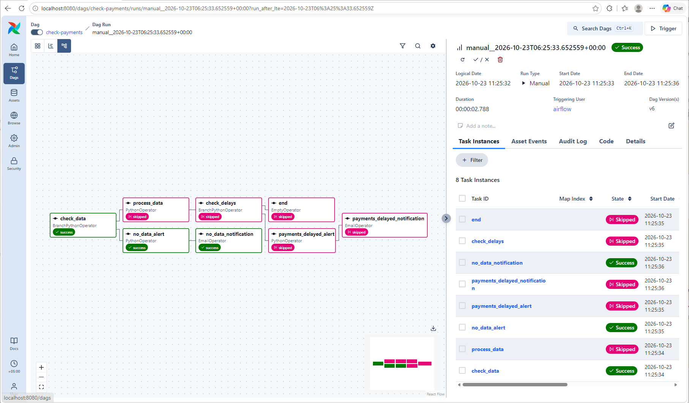
**Cценарий c Email алертом из-за отсутствия данных с логом ошибок:**
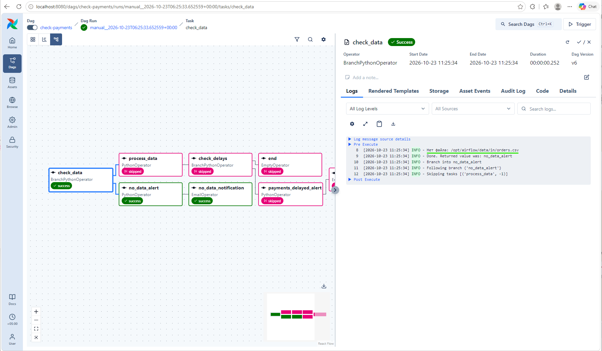

**Cценарий c Email алертом из-за задержки платежей**
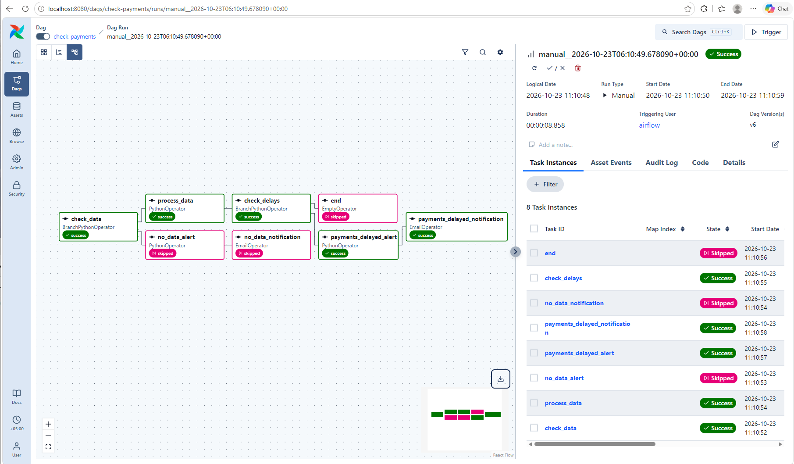

## Скриншоты нотификаций из почтового клиента ##

### Все нотификации ###

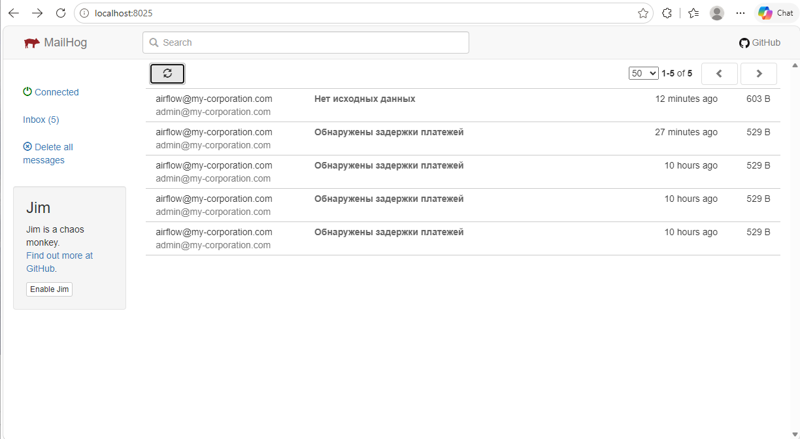

### Алерт: Задержка платежей ###

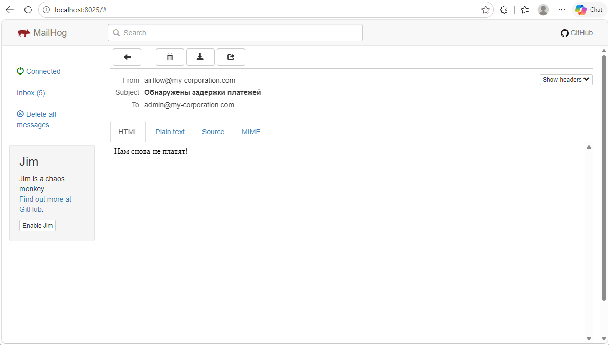

### Алерт: нет файлов данных ###

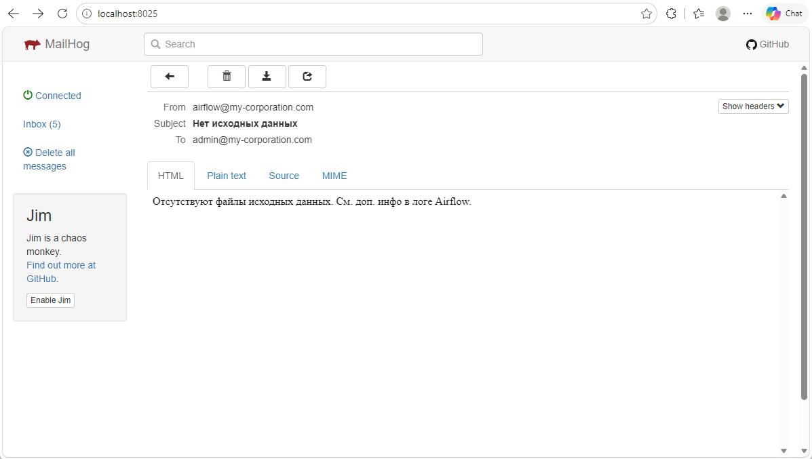
