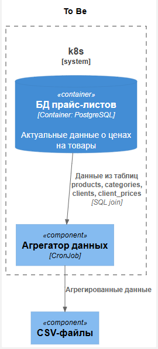

### **Разработка дизайна модуля пакетной обработки данных** 
### **Автор:** Иван Бабиков
### **Дата:** 23.10.2026
### **Функциональные требования**

**Введение**

Каждое утро ровно в шесть онлайн-магазину нужно сгенерировать кастомные CSV/XLS-прайс-листы для B2B-клиентов на основе текущих данных в БД. Процесс выгрузки не требует дополнительной логики по обработке данных. 

Данные в PostgreSQL представлены в таблицах:

- products ~ 5 000–10 000 строк;
- categories ~ 50–200 строк;
- clients ~ 100–500 строк;
- client_prices ~ 10 000–20 000 строк.

Необходимо связать данные из таблиц и выгрузить их в CSV-файл. Объём данных 5 000–10 000 строк. Инфраструктура магазина — микросервисы в облаке. 

|**№**|**Действующие лица или системы**|**Use Case**|**Описание**|
| :-: | :- | :- | :- |
| F1 | Автоматическая система || Должно производиться автоматическое создание CVS файла с витриной данных "Товары с ценами по клиентам, с разбиением по категориям внутри клиента" |

### **Нефункциональные требования**

|**№**|**Требование**|
| :-: | :- |
| P1 | Время выполнения процесса не более 2-ух часов |

### **Решение**

### Текущее состояние системы ###

### Сравнение вариантов по условным баллам ### 

|**Параметр**|**Spring Batch**|**Apache Airflow**|**K8s Job**|**Spark**|
| :-: | :- | :- | :- | :- |
| Ресурсоёмкость решения (количество потребляемых ресурсов) | 5 | 1 | 5 | 1 |
| Масштабируемость решения под нагрузкой и сложность реализации | 1 | 4 | 5 | 4 |
| Сложность развёртывания в облаке и интеграция с имеющейся микросервисной  архитектурой | 5 | 1 | 5 | 1 |
| Удобство интеграции с системами логирования и мониторинга  | 3 | 5 | 4 | 5 |
| **Итого**  | 14 | 11 | **19** | 11 |

### Обоснование оценок в таблице ###

1. Ресурсоёмкость решения (количество потребляемых ресурсов). Оценка отражает степень легковесности. 
- **Spring Batch:** Требует ресурсов только на время выполнения задачи - 5
- **Apache Airflow:** Постоянное потребление ресурсов - 1
- **K8s Job:** Требует ресурсов только на время выполнения задачи - 5
- **Spark:** Высокая - 1

2. Масштабируемость решения под нагрузкой и сложность реализации
- **Spring Batch:** Не масштабируется - 1.
- **Apache Airflow:** Встроенная поддержка горизонтального масштабирования - 4.
- **K8s Job:** Стандартное горизонтальное масштабирование в Kubernetes (HPA) - 5.
- **Spark:** Встроенная поддержка горизонтального масштабирования - 4.

3. Сложность развёртывания в облаке и интеграция с имеющейся микросервисной  архитектурой. Оценка отражает степень легкости. 
- **Spring Batch:** Низкая, развёртывается как микросервис - 5.
- **Apache Airflow:** Высокая, требуется кластер - 1.
- **K8s Job:** Хорошая поддержка в облачных средах - 5.
- **Spark:** Высокая, через Spark-кластер - 1.

4. Удобство интеграции с системами логирования и мониторинга
- **Spring Batch:** С помощью Actuator/Micrometer или Prometheus/Grafana, но может потребовать написания кода - 3.
- **Apache Airflow:** Встроенный мониторинг - 5.
- **K8s Job:** Мониторинг через интеграцию с Prometeus - 4.
- **Spark:** Встроенный мониторинг - 5.

По совокупности параметров было выбрано решение **K8s Job**.

### Ожидаемое состояние системы ###

### **Альтернативы**

Вторым по рейтингу идёт решение **Spring Batch**, что в полне логично, так как решение требуется легковесное, а Spring Batch по сути обычная программа. Но простота данного решения требует дополнительных настроек внутри Kubernetes.
