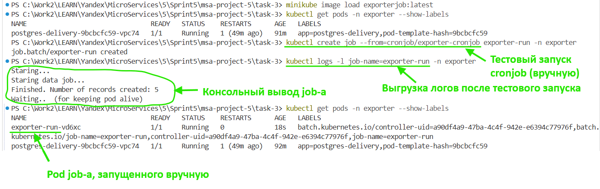

# Задание 3. Реализация Distributed Scheduling с k8s CronJob #

Онлайн-платформа занимается грузоперевозками. Каждый день ровно в восемь вечера ей нужно выгружать данные в специализированное хранилище для аналитиков. На основе выгруженных данных обновляются дашборды дневной отчётности. В связи с текущим стеком и опытом разработчиков остановили на k8s CronJob.

Ежедневный объём данных включает следующие таблицы:

- shipments (перевозки) ~ 50 000–200 000 строк;
- shipment_events (события по перевозкам) ~ 500 000–1 000 000 строк;
- drivers (водители) ~ 1 000–5 000 строк;
- vehicles (транспорт) ~ 500–2 000 строк;
- clients (заказчики) ~ 10 000–50 000 строк.

## Что нужно сделать ##

Подготовьте yaml-файлы конфигурации, которые выполняют требуемый функционал. Достаточно реализовать метод простого экспорта данных одной таблицы из БД на удобном вам языке программирования. 

В результате у вас должны получиться конфигурационные файлы для создания Docker-образа, конфигурационные файлы k8s job, чтобы использовать Docker-образа с cron-конфигурацией, а также видео или скриншоты, которые продемонстрируют работу k8s job в MiniKube.

Загрузите всё в директорию Task3 вашего репозитория.

## План реализации ##

1. Создать БД и программу импорта в Docker и проверить.
2. Создать среду MiniKube.
3. Создать манифест для CronJob.
4. Проверить работу CronJob в MiniKube.

## Как запускать ##

Задеплоить в minikube:
`./deploy.bat`

Для быстрой проверки:

1. Запустить job вручную `kubectl create job --from=cronjob/exporter-cronjob exporter-run -n exporter`
2. Просмотреть логи по job-у с заданными именем *exporter-run* `kubectl logs -l job-name=exporter-run -n exporter`
3. Получить список подов в namespace данной системы *exporter* `kubectl get pods -n exporter --show-labels`
4. Выгрузить созданный job-ом файл: `kubectl cp exporter/exporter-run-vd6xc:/export/report.csv ./report.csv`

## Результаты ##

Запуск job-а вручную в терминале и выгрузка логов:

Файл отчёта `report.csv`.