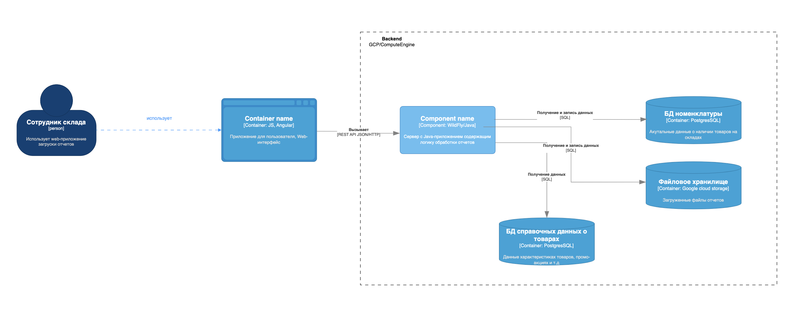
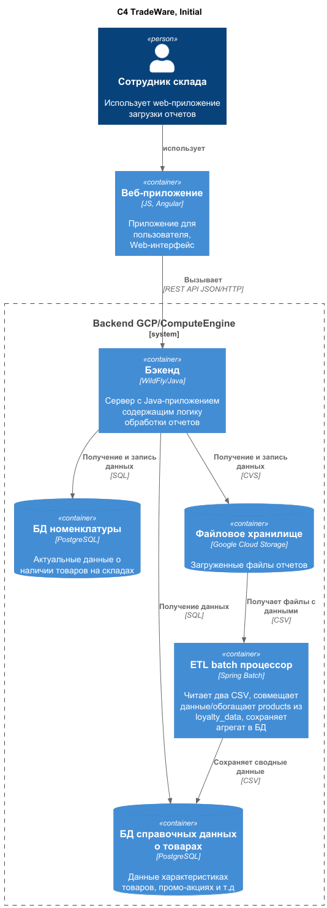

### **Название задачи: Реализация ETL с использованием Spring Batch** 
### **Автор:** Иван Бабиков
### **Дата:** 26.10.26
### **Функциональные требования**

|**№**|**Действующие лица или системы**|**Use Case**|**Описание**|
| :-: | :- | :- | :- |
|F1| Система ||Прочитать данные из CSV-файлов, агрегировать информацию и сохранить в результирующую таблицу в PostgreSQL|
|F2| Система ||Валидировать формат и целостность поступающих данных.|
|F3| Система ||Обновлять позиции актуальной справочной информацией на основе обновлений на складах, изменений промоакций и так далее.|
|F4| Система || Наличие системы централизованного сбора логов и метрик|

### **Нефункциональные требования**

|**№**|**Требование**|
| :-: | :- |
|P1| Обрабатывать 400 000 строк в сутки |
|P2| Справляться с параллельной нагрузкой в 100–150 параллельных загрузок |
|P3| Среднее время обработки отчёта на 2 000 строк менее 30 секунд |
|P4| Иметь возможность автомасштабироватся для обработки троекратной нагрузки |

#### Начальное состояние системы ####

### **Решение**

Предложенное решение **Java Spring Batch**.

Обоснование:

1. Команда пишет на Java.
2. У экспертов команды есть опыт работы только со Spring Batch

#### Конечное состояние системы ####

### **Альтернативы**

|**Решение**|**Недостатки**|
| :-: | :- |
| Apache Airflow | Тяжёлая и незнакомая для команды система. |
| Библиотека Quartz для Java | Незнакомая для команды библиотека, сложность настройки планирования задач, слабые встроенные механизмы обработки ошибок, нет встроенной защиты от параллельного запуска |

