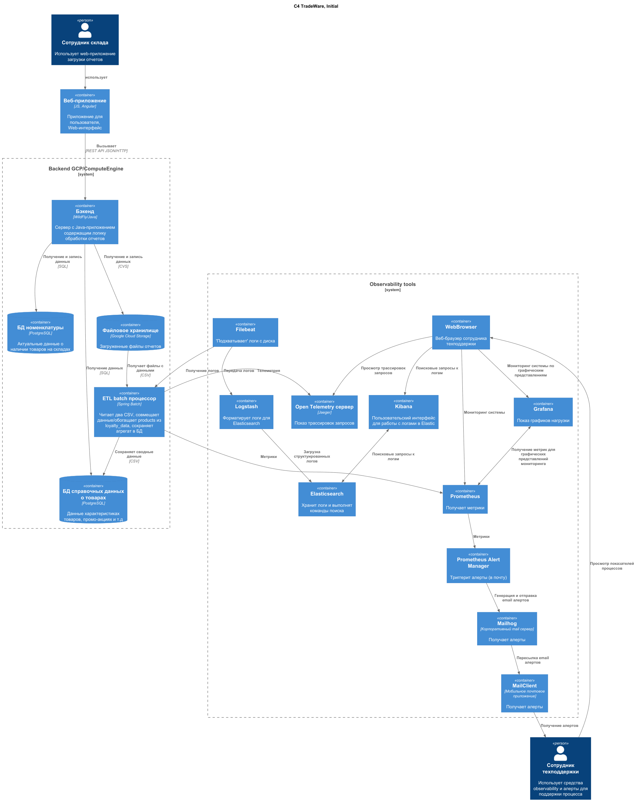
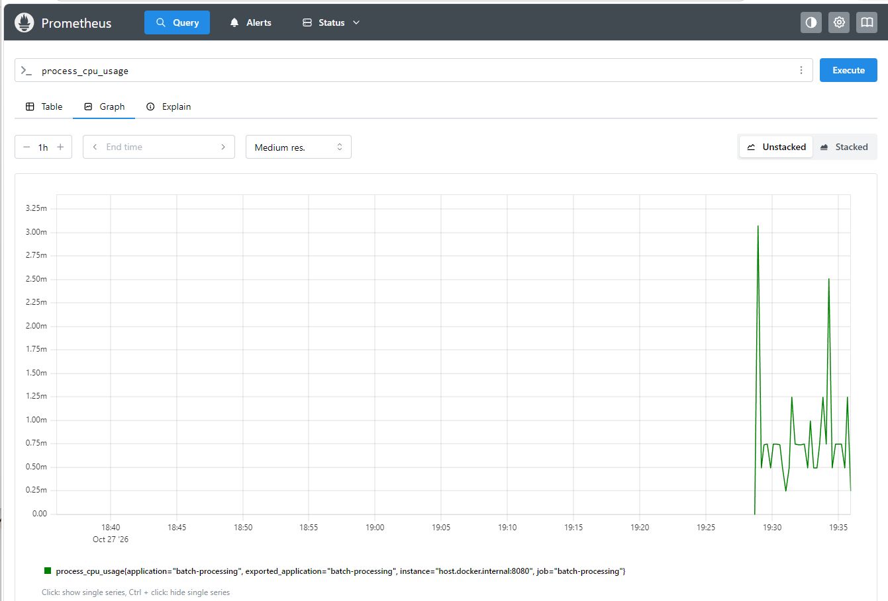
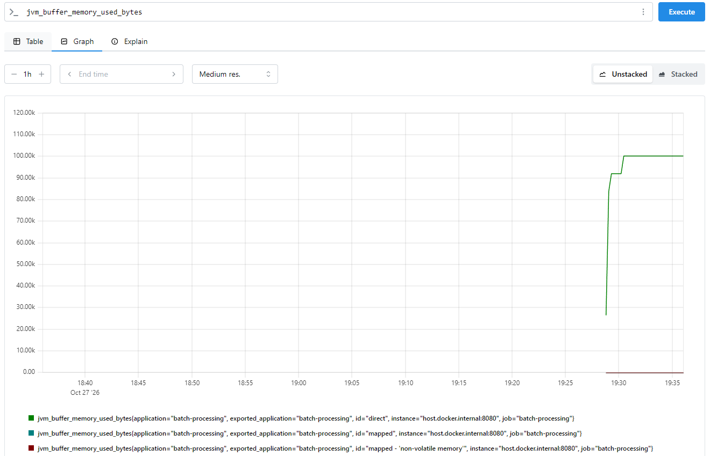
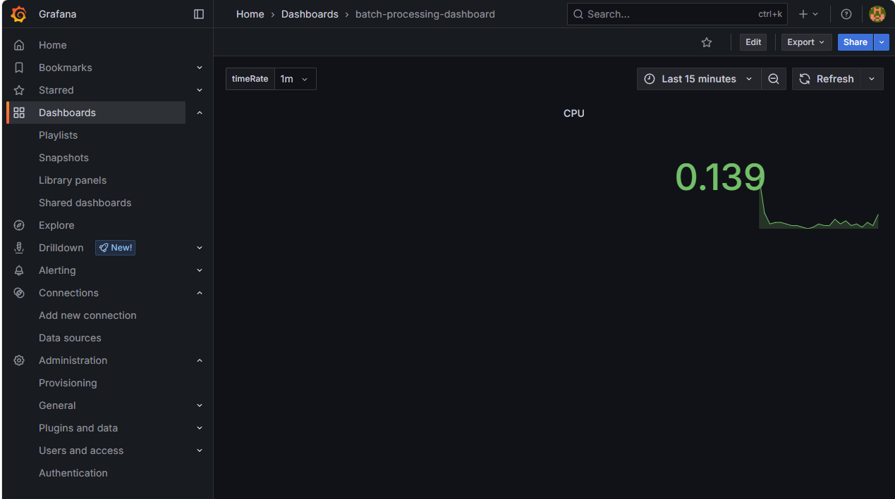
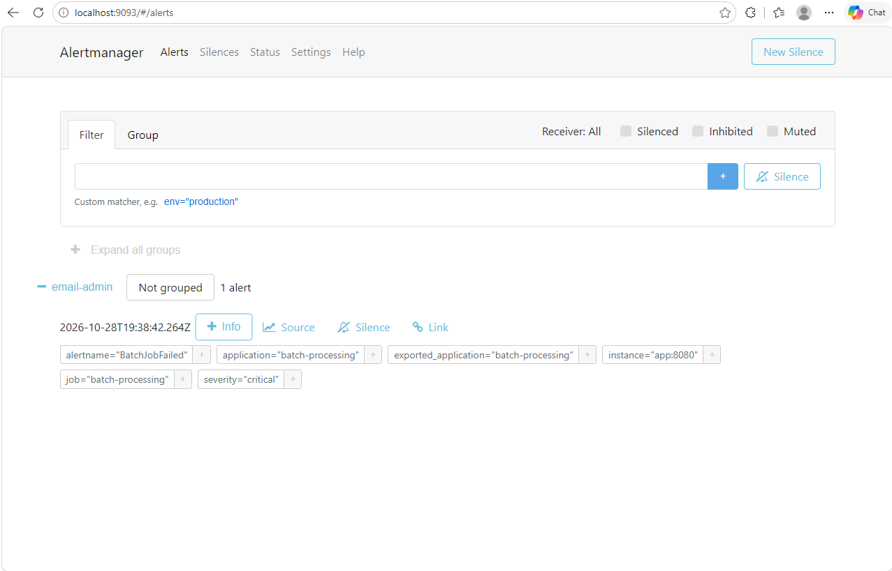
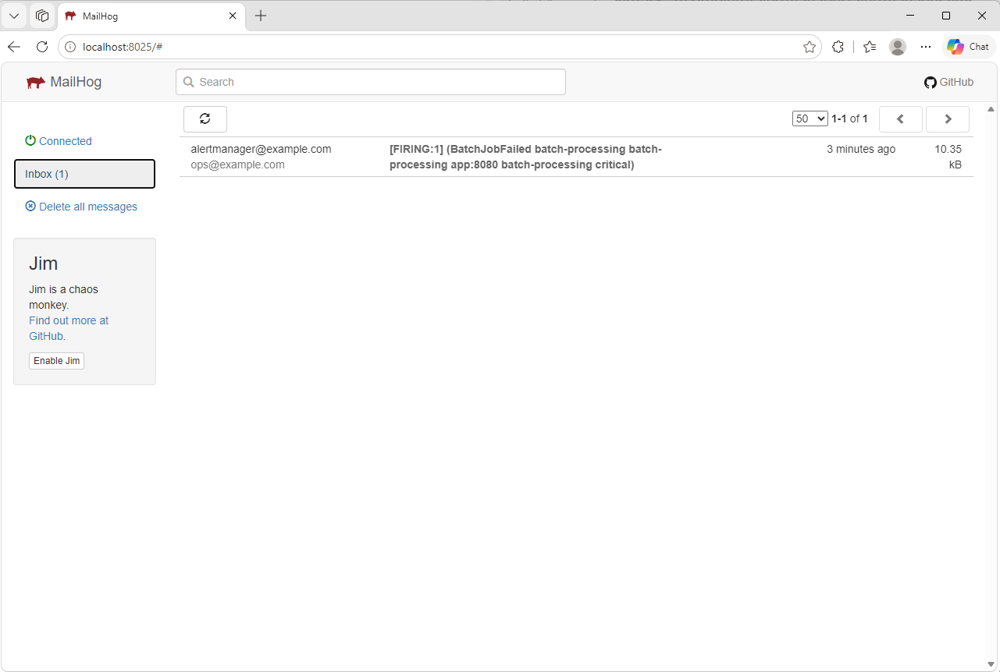
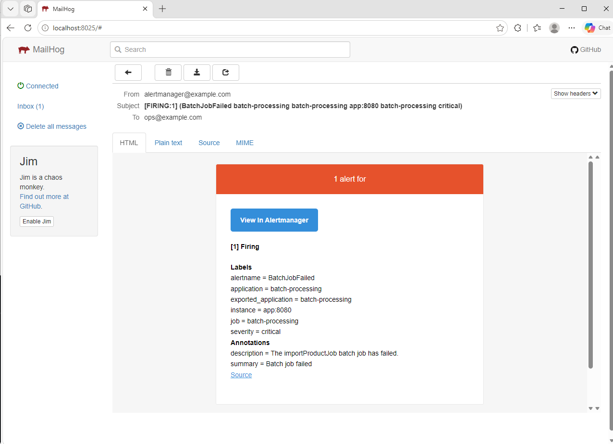
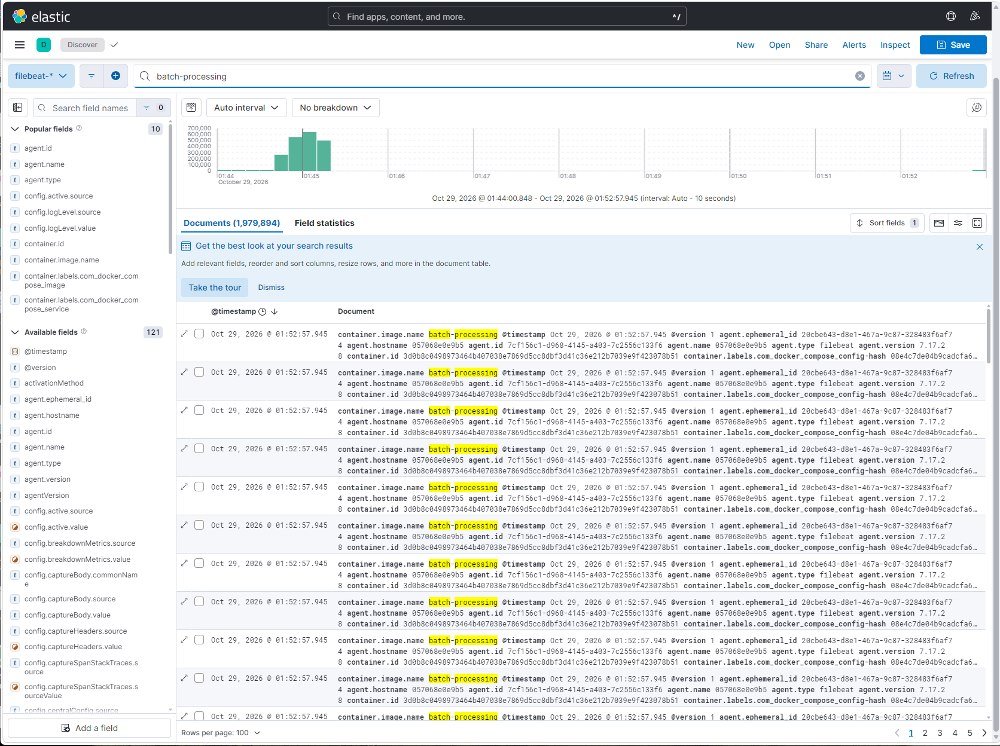
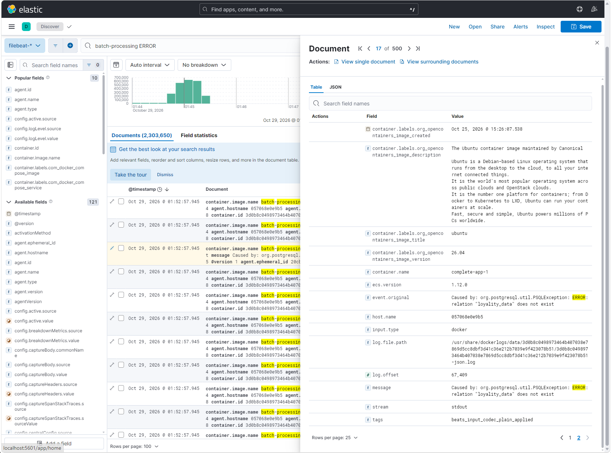

# Задача #

Представить проект по мониторингу/логированию/оповещению, на котором отобразить ключевые метрики, данные для логов и диаграмму с архитектурой решения.

# Решение #

## ADR файлы решения ##

**ADR задачи мониторинга**
`ADR-05-1.md`

**ADR задачи генерации алертов**
`ADR-05-2.md`

## Диаграмма решения ##

## Скриншоты реализованного решения ##

### Метрики в Prometheus ###

### Метрики в Grafana ###

### Алерты в Alert Manager ###

### Алерты в почте ###

### Логи в Kibana ###

