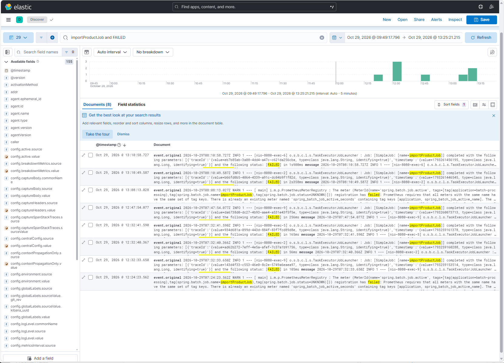
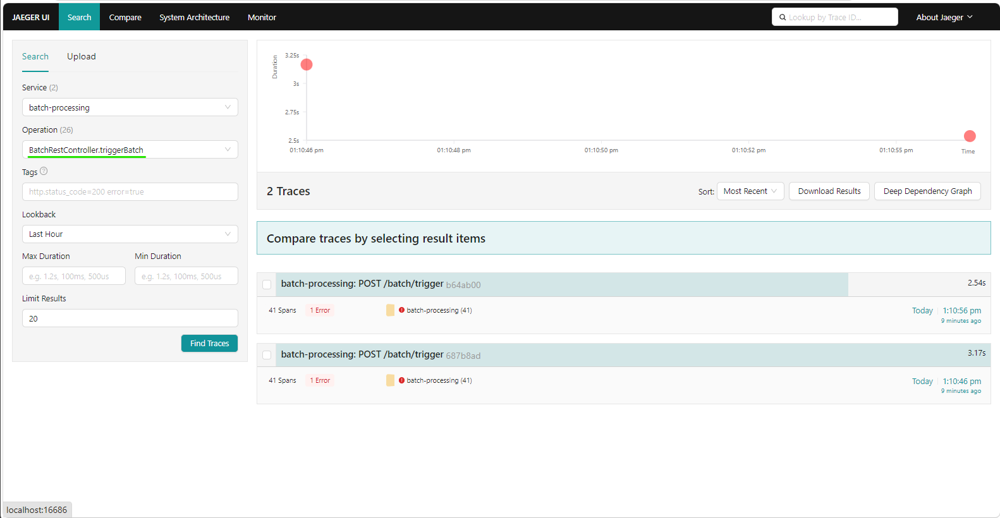
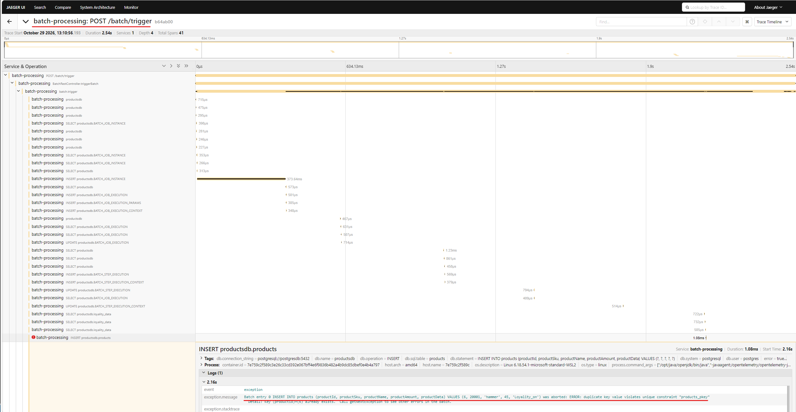
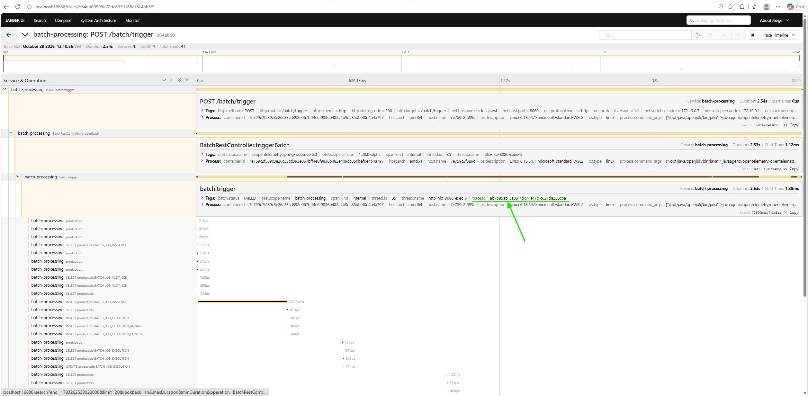
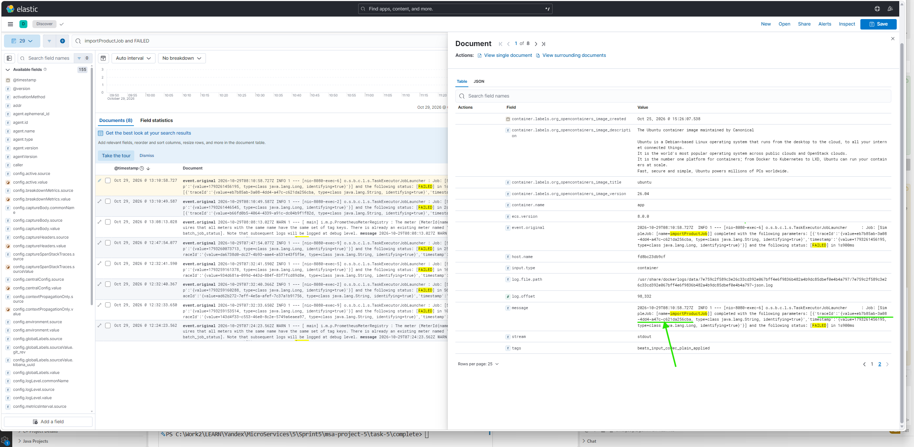

# Задача #

Доработайте Spring Batch-приложение, реализовав API запуска имеющейся ETL-задачи. Spring Batch-задача теперь должна запускаться не при запуске приложения, а при вызове на endpoint. Также нужно реализовать клиента (на любом удобном для вас языке программирования), который будет вызывать API запуска задачи.

Вызов API должен сопровождаться логированием с трейсингом запросов. У контекста запроса должно быть traceId, spanId, URI.  

Подумайте о том, с помощью чего лучше это сделать, и выберите наиболее подходящее решение для задачи.  

# Решение #

## Скриншоты реализованного решения ##

### Поиск по логам в Kibana ###

### Трассировки в Jaeger ###

### Детализация ошибки по трассировке в Jaeger ###

### Просмотр данных по trace.Id в Jeager и Kibana ###

